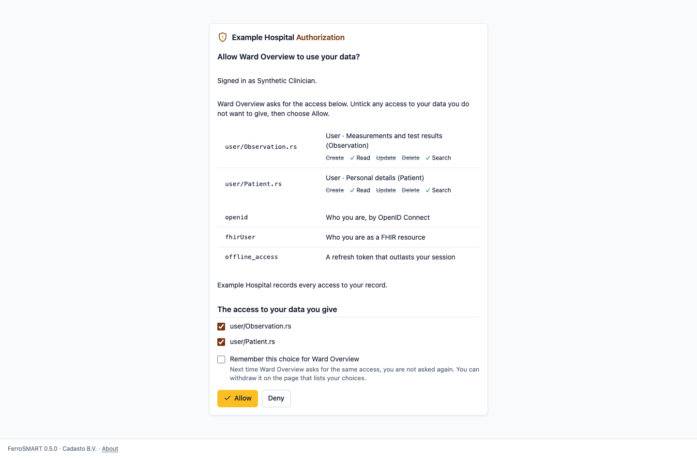

<!-- SPDX-FileCopyrightText: Cadasto B.V. -->
<!-- SPDX-License-Identifier: BUSL-1.1 -->
<div align="center">


**The SMART authorization server of the FerroHEALTH products, and the Rust libraries they check sign-in and access with.**

[Website](https://ferrosmart.eu/) ·
[Documentation](https://ferrosmart.eu/docs/) ·
[The crates](#the-crates) ·
[Install](#install) ·
[Licensing](https://ferrohealth.eu/docs/licensing.html)

**Project**<br>
[](https://github.com/FerroHEALTH/FerroSMART/actions/workflows/ci.yml)
[](LICENSE)
[](https://docs.rs/ferrohealth-smart)

**Quality and security**<br>
[](https://scorecard.dev/viewer/?uri=github.com/FerroHEALTH/FerroSMART)
[](https://github.com/FerroHEALTH/FerroSMART/actions/workflows/codeql.yml)
[](https://github.com/FerroHEALTH/FerroSMART/actions/workflows/oidf-verifier.yml?query=branch%3Amain)
[](docs/release.md)
[](docs/release.md)

**Conformance**<br>
<sub>(self-tested and self-assessed counts; none is a certification)</sub><br>
[](docs/conformance.md)
[](docs/conformance.md)
[](docs/conformance.md)
[](docs/conformance.md)
[](docs/conformance.md)
[](docs/conformance.md)
[](docs/post-quantum.md)

</div>

## What FerroSMART does

Every health application has to answer two questions on every request: who
is asking, and may they do this? Getting either wrong exposes patient data.
FerroSMART answers both, for every FerroHEALTH product and for any other
FHIR or openEHR server.

### The SMART authorization server

Most sign-in systems cannot issue real SMART tokens: they drop the SMART
scopes and the launch context a health app asks for. FerroSMART fills that
gap. It is a SMART App Launch 2.x authorization server that sits beside
your sign-in system: people still log in there, and FerroSMART issues the
SMART access tokens, with the patient and encounter context, the scopes the
user approved and an OpenID Connect identity, for any FHIR or openEHR server.
It speaks only published standards (SMART App Launch 2.2, OAuth 2.0 and its
RFCs, OpenID Connect), so it works with any OpenID Connect sign-in system
upstream and any FHIR server downstream.

<picture>
  <source media="(prefers-color-scheme: dark)" srcset="website/book/src/integrate/img/consent-clinician-dark.png">
  
</picture>

The server lives in this repository (its design is
[`docs/architecture.md`](docs/architecture.md) §13, its code
[`app/ferrosmart`](app/ferrosmart)) and ships as its own container image,
`ghcr.io/ferrohealth/ferrosmart`, beside the crates. Its book, for
operators and integrators, is at <https://ferrosmart.eu/docs/>.

#### Identity providers

People log in at your identity provider, and FerroSMART authenticates to
it with `private_key_jwt` alone (OpenID Connect Core 1.0 §9). Each
assertion names the provider's issuer as its only audience (RFC 10070 §4).
No code in FerroSMART knows a vendor; four providers have a documented,
tested setup:

| Provider | Login | Client authentication | `fhirUser` | Roles | Tested by |
|---|---|---|---|---|---|
| Keycloak | the realm's login form | Signed JWT, reading FerroSMART's `{issuer}/upstream-jwks` | a user attribute mapper | a realm role mapper | a launch in CI, and the compose quickstart |
| ZITADEL | the Login v2 UI | Private Key JWT, with a key ZITADEL generates | an Actions v2 target, from user metadata | the project role claim | a launch in CI |
| Microsoft Entra ID | one tenant's sign-in | a certificate credential | a directory extension attribute | app roles | a contract test against Entra ID's documents |
| Okta | the `default` custom authorization server | a public key on the integration | a custom claim | a groups claim | a contract test against Okta's documents |

Keycloak and ZITADEL accept the issuer audience by their source code.
Entra ID and Okta document the token endpoint instead, and rely on
RFC 10070 §6 until a live tenant confirms them (#620). The setup of each
is in the book's
[identity providers](https://ferrosmart.eu/docs/install/upstream.html) page
and in `docs/architecture.md` §13.16 to §13.22.

### The libraries

The libraries run no login page and issue no tokens. Each FerroHEALTH
server uses them to check the access tokens FerroSMART, or a hospital's own
sign-in system (such as Keycloak or Microsoft Entra ID), hands out: is the
token genuine, still valid, meant for this server, and does it grant this
action on this patient's record? They speak SMART, the standard health apps
use to ask for access to openEHR and FHIR data.

### Who it is for

- **Hospital IT and security teams**, who can connect every FerroHEALTH
  product to their own identity provider and see one audit line per
  request.
- **Developers of health software in Rust**, who need SMART access checks
  and machine-to-machine sign-in without writing them again.

### Why you can trust what it claims

Every release is signed and carries SLSA build provenance, so you can check
that the crate you use is the one built here. The source is public, and
every function is in this repository: there is no paid edition with extra
features. The OAuth 2.0, SMART and OpenID Connect specifications the crates
implement are vendored in the repository at the versions
[`docs/VERSIONS.md`](docs/VERSIONS.md) pins, so you can check each check
against its standard.

## Part of FerroHEALTH

FerroHEALTH is six servers, each its own product, that reach each other
only over published standards: FerroEHR stores the record, FerroBRIDGE
translates it to FHIR and the OMOP research model, FerroFED connects records
across organisations and borders, FerroPIX matches patient identities,
FerroTERM serves the code systems (the shared lists of medical terms), and
FerroSMART issues the SMART access tokens. Every FerroHEALTH server checks
its callers with FerroSMART's `ferrohealth-smart`. Work that every server
needs lives in shared libraries: FerroAUDIT for the audit trail, FerroUI
for the web consoles and FerroSYS for the system plumbing.

## The crates

Each crate is published on crates.io on its own version line and has its
own README, which is its crates.io page.

| Crate | Version | What it provides | Features |
|---|---|---|---|
| [`ferrohealth-smart`](crates/ferrohealth-smart/README.md) | [](https://crates.io/crates/ferrohealth-smart) | The SMART App Launch 2.x and OAuth 2.0 resource server: token checks, the SMART on openEHR and SMART on FHIR scopes, roles and caller kinds, machine sign-in and the audit line | `fetch` (default), `axum`, `oidc`, `openehr`, `openehr-scopes`, `ehdsi-assertion`, `xml`, `server-tls`, `schema`, `test-support` |
| [`ferrohealth-authz`](crates/ferrohealth-authz/README.md) | [](https://crates.io/crates/ferrohealth-authz) | The policy decision: attribute-based access over the authenticated caller, with an embedded Cedar engine or a remote decision point | `cedar`, `remote` |
| [`ferrohealth-session`](crates/ferrohealth-session/README.md) | [](https://crates.io/crates/ferrohealth-session) | The operator consoles' OpenID Connect sign-in with PKCE and their session: an in-process store, idle and absolute lifetimes, token refresh and the session-watch route | `axum`, `schema`, `test-clock` |

## What it provides

- **Token checks:** `ferrohealth-smart` reads the authorization server's
  metadata and keys, rotates them, and checks every JWT access token under
  RFC 9068: the signature, issuer, audience, lifetime and token type. An
  opaque token is checked by RFC 7662 introspection.
- **SMART on openEHR scopes** for templates, compositions and AQL queries,
  with the patient's EHR from the launch context (feature `openehr`). The
  scope grammar alone (`openehr-scopes`) builds for
  `wasm32-unknown-unknown`, so a browser client parses a scope with the
  parser the server enforces it with.
- **SMART on FHIR scopes** (`patient/`, `user/`, `system/`) with the
  patient compartment, beside the openEHR scopes in one token.
- **Roles, caller kinds and assurance levels** read from the token, for a
  product's route table, with issuer profiles for Keycloak, Microsoft
  Entra ID, Okta and plain RFC 9068.
- **Basic sign-in and machine calls:** HTTP Basic against Argon2id hashes,
  and the OAuth 2.0 client credentials grant with a cached token for calls
  upstream, renewed once when the upstream answers `401`.
- **The router guard** (feature `axum`): one tower layer runs the credential
  check, the scope check and the audit line in front of every route.
- **One audit line per request**, never with the token or any content.
- **The SMART discovery document** a product publishes for its clients.
- **The policy decision:** `ferrohealth-authz` puts the authenticated
  caller, the action and the resource attributes to an embedded Cedar
  engine, whose policies are validated strictly before they run, or to a
  remote decision point. An engine that cannot decide is a fault, never a
  permit.
- **The console sign-in:** `ferrohealth-session` runs the OpenID Connect
  authorization code flow with PKCE and keeps the operator's session with
  idle and absolute lifetimes.

## Install

The crates need Rust 1.98 or newer (edition 2024). Pin each version
exactly, as every FerroHEALTH product does:

```toml
[dependencies]
ferrohealth-smart = { version = "=0.35.0", features = ["axum", "openehr"] }
ferrohealth-authz = { version = "=0.28.0", features = ["cedar"] }
ferrohealth-session = { version = "=0.32.0", features = ["axum"] }
```

The release plan of each crate refuses a tag while this page or the crate's
own README pins another version, so the lines above are the released ones.

## Usage

Guard an axum router: the layer checks the bearer token against the
issuer's keys, holds it to the SMART permission each route needs, and hands
the handler the caller it admitted.

```rust,no_run
# #![allow(dead_code)]
use std::sync::Arc;

use axum::Router;
use axum::routing::get;
use ferrohealth_smart::guard::{AuthLayer, Gate, Requirement, Target};
use ferrohealth_smart::kind::IssuerKind;
use ferrohealth_smart::resource::{Access, ResourceServer, Settings, Verifier};
use ferrohealth_smart::scope::Permission;
use http::{Extensions, Method, Uri};

async fn read(access: Access) -> String {
    access
        .caller()
        .map_or(String::from("open"), |caller| caller.subject().to_owned())
}

fn classify(_method: &Method, uri: &Uri, _extensions: &Extensions) -> Option<Target> {
    let resource_type = uri.path().trim_start_matches("/fhir/").split('/').next()?;
    let requirement = Requirement::Fhir {
        permission: Permission::Read,
        resource_type: resource_type.to_owned(),
    };
    Some(
        Target::new("read", requirement)
            .route("/fhir/{resource_type}/{id}")
            .target(uri.path().trim_start_matches("/fhir/")),
    )
}

# async fn build() -> Result<Router, Box<dyn std::error::Error>> {
let settings = Settings::new(
    "https://as.example.org/realms/ferro",
    "https://bridge.example.org/fhir",
    IssuerKind::Smart,
);
let verifier: Arc<dyn Verifier> = Arc::new(ResourceServer::discover(settings).await?);
let gate = Gate::open().with_bearer(verifier).with_realm("ferrobridge");
let app = Router::new()
    .route("/fhir/{resource_type}/{id}", get(read))
    .layer(AuthLayer::new(gate, classify));
# Ok(app)
# }
```

CI compiles this example as a doctest of `ferrohealth-smart`. The crate
READMEs show the rest: an openEHR route and a call upstream with the client
credentials grant in [`ferrohealth-smart`](crates/ferrohealth-smart/README.md),
a Cedar decision in [`ferrohealth-authz`](crates/ferrohealth-authz/README.md),
and the `[oidc]` and `[session]` sections in
[`ferrohealth-session`](crates/ferrohealth-session/README.md).

## Configuration

A product reads its `[auth]` section through `ferrohealth-config`: one
`[auth.issuer.<name>]` table per authorization server, named so every
other key and the environment address it by name, each with a `profile`
preset and a `kind` (`persons`, `patients`, `machines` or `federation`)
that defaults to the preset's,
`[[auth.basic.users]]` for HTTP Basic credentials, and `<key>_file` for every
secret. An unknown key is refused when the configuration loads.
[`docs/architecture.md`](docs/architecture.md) has the full configuration
model, each check cited to its specification section.

## Security

- The library crates run no login page, issue no token and hold no signing
  key: a hospital keeps its own identity provider, and the crates check what
  its authorization server hands out. FerroSMART is the one part of this
  repository that issues tokens and holds signing keys, and it leaves login
  to the identity provider.
- The audit line has a fixed field set and never carries the token or any
  request content.
- The crates contain no `unsafe` code (`unsafe_code = "forbid"`), and
  `cargo-deny` checks every dependency on every pull request.
- Every release is signed and carries SLSA build provenance
  ([`docs/release.md`](docs/release.md)).
- Report a vulnerability privately as the [security policy](SECURITY.md)
  describes.

## Versioning

Each crate follows [Cargo's SemVer rules](https://doc.rust-lang.org/cargo/reference/semver.html)
on its own version line and is released by its own tag, `<crate>-vX.Y.Z`,
with its own changelog:
[`ferrohealth-smart`](crates/ferrohealth-smart/CHANGELOG.md),
[`ferrohealth-authz`](crates/ferrohealth-authz/CHANGELOG.md) and
[`ferrohealth-session`](crates/ferrohealth-session/CHANGELOG.md). On a
`0.x` line a public API break moves the minor version. Every pull request
runs [`cargo-semver-checks`](https://github.com/obi1kenobi/cargo-semver-checks)
against each changed crate's newest release on crates.io and refuses a
break the manifest version does not allow.

## Documentation

- The API reference on docs.rs:
  [`ferrohealth-smart`](https://docs.rs/ferrohealth-smart),
  [`ferrohealth-authz`](https://docs.rs/ferrohealth-authz) and
  [`ferrohealth-session`](https://docs.rs/ferrohealth-session).
- The [architecture](docs/architecture.md) and the
  [pinned specifications](docs/VERSIONS.md).
- The [release process](docs/release.md).
- The [FerroHEALTH book](https://ferrohealth.eu/docs/).

## Support

[SUPPORT.md](SUPPORT.md) says where to ask a question and how to report a
defect. Read [CONTRIBUTING.md](CONTRIBUTING.md) and the
[code of conduct](CODE_OF_CONDUCT.md) before you open a pull request;
[GOVERNANCE.md](GOVERNANCE.md) and [MAINTAINERS.md](MAINTAINERS.md) say who
decides and who reviews.

## Licence

Business Source License 1.1 ([LICENSE](LICENSE), [NOTICE](NOTICE)), with
Apache License 2.0 as the Change License four years after each version.
Non-production use and non-commercial production use are free; the
[licensing page](https://ferrohealth.eu/docs/licensing.html) says when you
need a commercial licence from Cadasto B.V.
