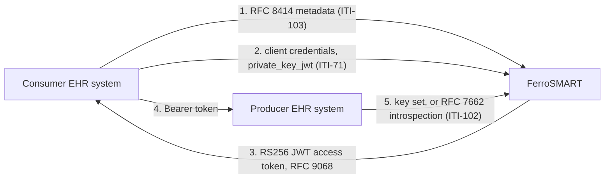

<!-- SPDX-FileCopyrightText: Cadasto B.V. -->
<!-- SPDX-License-Identifier: BUSL-1.1 -->

# Xt-EHR system authorization

Xt-EHR deliverable D8.2 (2026-05-19), §5.1.2, suggests testable forms for
the system authorization requirements that deliverable D5.1 sets for the
interoperability component of an EHR system. This page compares each of
its assertions with what FerroSMART does, so you can see where a
deployment of FerroSMART meets one and where it takes another route.

## Where FerroSMART stands

FerroSMART authorizes with OAuth 2.0 and
[SMART App Launch 2.2.0](https://hl7.org/fhir/smart-app-launch/STU2.2/),
and issues JWT access tokens under RFC 9068. In the terms of
[IHE IUA](https://profiles.ihe.net/ITI/IUA/), it is an Authorization Server
with the JWT Token option, the Token Introspection option and the
Authorization Server Metadata option. It does not issue IUA SAML tokens
and does not publish OASIS SMP documents. The owner decided this on
2026-11-24 (FerroHEALTH/FerroSMART#858), for three reasons:

- D8.2 gives the SAML token and SMP forms as examples. Each heads its
  column "Suggestion for testable implementation (Example)", beside the
  normative D5.1 requirement it tests.
- The draft act on the EHDS testing environment (initiative 17513) does
  not adopt these assertions.
- HL7 Europe's guides and SMART on FHIR authorize with OAuth 2.0, and IUA
  allows the JWT Token option alongside the SAML one (IUA §34.2, Note 1:
  an Authorization Server supports at least one of JWT, SAML or Token
  Introspection).

SAML assertions for MyHealth@EU belong to FerroFED, on the eHDSI side,
where the exchange between national contact points uses them.

D8.2 draws the same five steps with an SMP registry in step 1 and a SAML
token in steps 3 and 4.

## The assertions, row by row

The normative text is D5.1's, as D8.2 §5.1.2 quotes it. "Producer" and
"consumer" are the interoperability component in each role. FerroSMART is
the authorization server a producer points to. The consumer and resource
server rows describe the products that use `ferrohealth-smart`, the
family's resource-server and client library, which this repository also
ships.

### `api-producer-authDiscovery`

The component SHALL enable discovery of its authorization server
information, through machine-discoverable metadata or out of band.

| Assertion | D8.2 suggests | FerroSMART |
|---|---|---|
| `TA-api-producer-authDiscovery-01` | Create an OASIS SMP `SignedServiceMetadata` document, sign it and push it to an SMP registry; or provide the information through a documented, version-controlled out-of-band process | Meets the normative requirement through machine-discoverable metadata of another form: RFC 8414 authorization server metadata, OpenID Connect Discovery and `/.well-known/smart-configuration`, each under the issuer (IUA Authorization Server Metadata option, ITI-103). No SMP document is written or pushed. |
| `TA-api-producer-authDiscovery-02` | Refuse to publish an SMP document that fails the schema or signature rules, and log an error | Not applicable: FerroSMART publishes no SMP document. Its metadata is built from the loaded configuration, which is checked when the server starts. |
| `TA-api-producer-authDiscovery-03` | Report a failed push to the SMP registry and retry, or offer configurable error handling | Not applicable: nothing is pushed. A consumer reads the metadata from FerroSMART itself. |

### `api-producer-authProvideToken`

The component SHALL support issuing authorization tokens to consumer EHR
systems using the consumer's registered identity credentials and scopes of
access.

| Assertion | D8.2 suggests | FerroSMART |
|---|---|---|
| `TA-api-producer-authProvideToken-01` | Issue a token per IHE IUA as a SAML token of the IUA SAML Token option, with the scopes authorized for the consumer | Meets the normative requirement with the IUA JWT Token option. A registered consumer authenticates with a `private_key_jwt` assertion (RFC 7523, SMART Backend Services) or its secret, and gets a JWT access token whose `scope` is the request within the client's registered ceiling (ITI-71, client credentials). The token is a JWT, never a SAML assertion. |
| `TA-api-producer-authProvideToken-02` | Refuse invalid, expired, revoked or unregistered credentials with an IUA error response, issuing no token | Meets it. Every failed client authentication answers `invalid_client` (RFC 6749 §5.2), the error IUA ITI-71 takes from OAuth 2.1 §5.3, and no token is issued. An assertion's `jti` is accepted once. |
| `TA-api-producer-authProvideToken-03` | Deny scopes not permitted for the consumer with an IUA authorization failure, and never grant beyond them | Meets it, with one difference. FerroSMART grants the requested scopes that fall within the client's ceiling and leaves out the others (SMART Backend Services, Evaluate Requested Access). When none fall within it, it answers `invalid_scope`. A token never carries a scope beyond the ceiling. |
| `TA-api-producer-authProvideToken-04` | Sign the SAML token per IUA, with issuer, audience, validity and subject, in the IUA XML schema | Meets the token content in the JWT form: an RS256 JWS (`typ` `at+jwt`) with `iss`, `aud`, `sub`, `client_id`, `jti`, `iat`, `exp` and `scope`, the claims IUA §3.71.4.2.2.1 requires. No SAML assertion or XML schema is involved. FerroSMART signs with RSA keys only and never HS256, although IUA lists HS256 as an algorithm the JWT option shall support. |
| `TA-api-producer-authProvideToken-05` | Refuse an expired SAML token with an IUA token-expired error | Meets it for its JWT tokens. A resource server using `ferrohealth-smart` refuses a token past `exp` with `401`, `error="invalid_token"` and `error_description="expired"` (RFC 6750 §3.1). FerroSMART's introspection answers `active: false` for it (RFC 7662 §2.2, ITI-102). |

### `api-consumer-authObtainToken`

The component SHALL obtain an authorization token from the producer's
designated authorization server.

| D8.2 suggests | FerroSMART and `ferrohealth-smart` |
|---|---|
| Import the producer's `SignedServiceMetadata` from the SMP registry | Meets the normative requirement without SMP. A product's token client (`ferrohealth-smart` `client`) reads the authorization server's RFC 8414 metadata and asks its token endpoint with client credentials. It fetches and caches the token and renews it once on a `401`. |

### `api-producer-authRequireToken`

The component SHALL require a valid authorization token from the consumer
on every exchange.

| D8.2 suggests | FerroSMART and `ferrohealth-smart` |
|---|---|
| Act as an IUA Resource Server with the SAML Token option | Meets the normative requirement as an IUA Resource Server with the JWT Token option. `ferrohealth-smart` refuses a request with no token, or with a token whose signature, `iss`, `aud`, `exp` or `nbf` fails, with `401` and `invalid_token`, and one without the scope the route needs with `403` and `insufficient_scope`. It never reads a SAML token. |

### `api-consumer-authPresentToken`

The component SHALL present a valid token to the producer on every
exchange.

| D8.2 suggests | FerroSMART and `ferrohealth-smart` |
|---|---|
| Act as an IUA Authorization Client that obtains a SAML token and puts it in its requests | Meets the normative requirement with a JWT. The token client puts the access token in the `Authorization: Bearer` header (RFC 6750 §2.1), as an IUA Authorization Client does with any token format (IUA §34.2, Note 1). |

## What a test against D8.2 would show

Run as written, the SMP test cases of D8.2 §5.2.1 and §5.2.2
(`SMP-Producer-scrutiny`, `SMP-Producer-push`, `SMP-consumer-fetch`,
`SMP-consumer-configure`) fail, since FerroSMART writes no SMP document.
`SMP-Producer-providerToken` fails where it checks for a SAML token. The
`noAuthentication` and `unauthorized` cases of the patient match and
document exchange tests check only that a request without a valid token
is refused. They pass against a resource server behind FerroSMART,
whatever the token format. If the Commission's test cases adopt the SAML
or SMP forms, the decision is taken again on its ground then.
