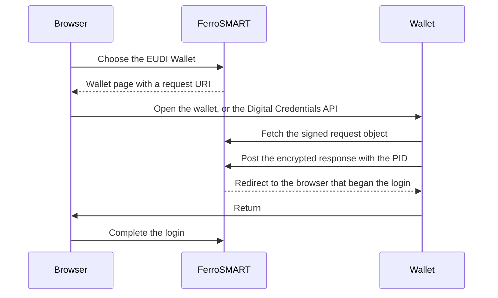

<!-- SPDX-FileCopyrightText: Cadasto B.V. -->
<!-- SPDX-License-Identifier: BUSL-1.1 -->

# The EUDI Wallet login and the PID

**For:** compliance readers and operators who need to know what FerroSMART
asks of a person's European Digital Identity Wallet, what it keeps and what
it refuses. The setup is on [log in with the EUDI Wallet](../install/wallet.md).

A person can log in by presenting the person identification data (PID) in
their wallet. FerroSMART is the verifier of OpenID4VP 1.0 under the
OpenID4VC High Assurance Interoperability Profile (HAIP) 1.0, with the
wallet profiles the EU's implementing acts apply. A wallet login counts
as level of assurance `high` (`http://eidas.europa.eu/LoA/high`).

## What FerroSMART asks for

The request object is signed with the wallet-relying party access key and
carries the registration certificate your registrar issued, so the wallet
can check who asks and what they may ask for (OpenID4VP 1.0 §5; HAIP 1.0
§5). It asks for the PID as an SD-JWT VC (`dc+sd-jwt`, type
`urn:eudi:pid:1` by default) or as an ISO mdoc (`mso_mdoc`, document type
`eu.europa.ec.eudi.pid.1`), and the wallet presents the one it holds.

The attributes come from the PID Rulebook (Implementing Regulation (EU)
2024/2977, Annex), which names each attribute and its name in each format:

| PID Rulebook attribute | SD-JWT VC claim | mdoc element | FerroSMART uses it as |
|---|---|---|---|
| `family_name` | `family_name` | `family_name` | ID Token `family_name`, under `profile` |
| `given_name` | `given_name` | `given_name` | ID Token `given_name`, under `profile` |
| `birth_date` | `birthdate` | `birth_date` | ID Token `birthdate`, under `profile` |
| `birth_place` | `place_of_birth` | `place_of_birth` | ID Token `place_of_birth`, under `profile` |
| `nationality` | `nationalities` | `nationality` | ID Token `nationalities`, under `profile` |
| `personal_administrative_number` | the same | the same | The person's identifier |
| `portrait` | `picture` | `portrait` | Never asked for, and dropped if a wallet sends it |

FerroSMART never retains the portrait: it identifies the person without it
(Implementing Regulation (EU) 2024/2977 Art 3a(3); GDPR Art 5(1)(c)). How a
PID becomes the claims of an ID Token is not set by any specification;
the mapping above is FerroSMART's own design.

## How a PID names a person

The PID's administrative number, with its `issuing_country`, names the
person. A PID without an administrative number is refused, because
FerroSMART never matches people by name and birth date.

- **The `sub`.** The person's FerroSMART `sub` is pairwise, a SHA-256 of
  the provider's issuer (here the first accepted credential type) and
  `<issuing country>:<administrative number>`. The administrative number
  never reaches a resource server.
- **The `fhirUser`.** A `fhirUser` lookup searches the FHIR server for a
  `Patient` with that identifier, or a patient index resolves it: the
  index is asked by PIXm ITI-83 or PDQm ITI-78 for the person's identifier
  in the server's own system, in the identifier system
  `identifier_systems` names for the issuing country. Exactly one patient
  becomes the `fhirUser` and the app's `patient`; none or several refuse
  the launch.

## What FerroSMART checks

Before it accepts a presentation, FerroSMART checks:

- that the response is encrypted to the request's own ephemeral key
  (ECDH-ES on P-256, A128GCM or A256GCM; OpenID4VP 1.0 §8.3, HAIP 1.0 §5);
- that the issuer's certificate path ends at one of the configured PID
  provider anchors, or at a provider on the Commission's list
  (Implementing Regulation (EU) 2024/2980 Art 5), which FerroSMART reads
  as ETSI TS 119 602 Annex D and verifies; a list that does not verify, or
  whose next update has passed, refuses every wallet login;
- the issuer's signature and the holder's key binding (RFC 9901 for an
  SD-JWT VC, COSE for an mdoc);
- that the credential has not expired and is not revoked in its Token
  Status List;
- that the nonce was not answered before, the type is one it asked for,
  and every claim it asked for is there.

Each refusal is a login record in the [audit](../operate/audit.md) naming
the reason.

## What stays classical

The wallet's own mechanisms (the request signature, the SD-JWT VC and mdoc
signatures, the response key agreement) use ECDSA and ECDH on P-256, as
HAIP 1.0 requires. They stay so until their post-quantum forms are
standardised ([signing keys and algorithms](signatures.md)).
