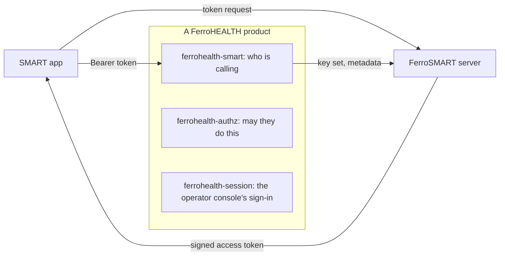

<!-- SPDX-FileCopyrightText: Cadasto B.V. -->
<!-- SPDX-License-Identifier: BUSL-1.1 -->

# The crates every product uses

**For:** integrators and architects who want to know how the FerroHEALTH
products check FerroSMART's tokens, and compliance readers who need to
know which component issues tokens and which only reads them.

The FerroSMART repository publishes three library crates beside the
server, each on crates.io under its own version line. Every product
(FerroBRIDGE, FerroEHR, FerroFED, FerroPIX and FerroTERM) links
`ferrohealth-smart`, and its operator console `ferrohealth-session`;
`ferrohealth-authz` is there for a product that embeds a policy engine. The
FerroSMART server links `ferrohealth-smart` too. None of the three issues a token or
holds a key that signs one: FerroSMART is the one component that does.

## `ferrohealth-smart`: who is calling

This crate makes a product an OAuth 2.0 and SMART App Launch 2.x resource
server, and lets it call other services as a client.

- **Reading a token.** It discovers the issuer's metadata (RFC 8414, with
  OpenID Connect Discovery 1.0 as the fallback), fetches and caches the
  key set, and checks a JWT access token under RFC 9068: an asymmetric
  signature, `iss`, `aud`, `exp` and `nbf` within a clock skew, and the
  `at+jwt` type. A token it cannot read as a JWT it can check by RFC 7662
  introspection instead.
- **Who stands behind it.** It reads the standard claims the same way for
  every issuer: a token whose `sub` is its `client_id` is a system caller,
  and a person is named by the resource type of their `fhirUser`
  (`Patient`, `Practitioner`, `PractitionerRole`, `RelatedPerson`,
  `Person`). The patient in the launch context, the person's roles
  (RFC 9068 §2.2.3.1) and the level of assurance come with it.
- **What the scopes allow.** It parses the SMART on FHIR scopes and, behind
  a feature, the SMART on openEHR scopes. A product's route table names
  the grammar each route is checked against.
- **Refusing.** A refusal is `401` with `error="invalid_token"` or `403`
  with `error="insufficient_scope"`, with a stable reason code
  ([refusal codes](../integrate/refusals.md)), and never a claim value.
- **Calling out.** The client credentials grant with a cache and one
  renewal on a `401`, HTTP Basic against Argon2id hashes, and the RFC 8693
  token exchange or RFC 7523 JWT bearer grant to call another service on a
  caller's behalf.
- **The audit line.** One log line per request under the `tracing` target
  `ferrohealth_smart::audit`, never with the token.

A product trusts FerroSMART with one `[auth.issuer.<name>]` table naming
its issuer ([put a server behind FerroSMART](../integrate/resource-server.md)).
The one private key the crate can hold is a product's own `private_key_jwt`
client credential, which signs only that product's client assertion to a
token endpoint (RFC 7523 §2.2).

## `ferrohealth-authz`: may they do this

`ferrohealth-smart` says who the caller is; `ferrohealth-authz` decides what
that subject may do with an object. Its request model follows NIST SP
800-162, attribute-based access control: subject, object and environment
attributes, a policy decision point, and the enforcement point that asks
it.

- Without a feature the crate holds the request model and the
  `PolicyEngine` trait alone.
- The `cedar` feature embeds an engine over the Cedar policy language. The
  product describes its model, and the crate writes the Cedar schema from
  it and validates every policy strictly before it runs.
- The `remote` feature asks a decision point over HTTP, authenticated with
  `ferrohealth-smart`'s client credentials token.

An engine that cannot decide answers an error, which a product treats as
its own fault (a `500`), never as a permit and never as a `403`.

## `ferrohealth-session`: the operator console's sign-in

A product's operator console signs its operators in at the deployment's
OpenID Provider with the authorization code flow and PKCE, through the
relying party of `ferrohealth-smart`, which keeps no state. This crate
keeps the pending sign-in between the redirect and the callback, and the
session once the sign-in completes: the operator's tokens stay in the
console's process, and the browser holds an opaque id in a cookie.

The store is memory only, so a console runs as one instance or behind
sticky sessions, and a restart signs every operator out
([run a console's sessions](../operate/console-sessions.md)).

## Where to read more

Each crate's API documentation is on docs.rs:
[`ferrohealth-smart`](https://docs.rs/ferrohealth-smart),
[`ferrohealth-authz`](https://docs.rs/ferrohealth-authz) and
[`ferrohealth-session`](https://docs.rs/ferrohealth-session). Each product's
own book describes the `[auth]` section it embeds.
