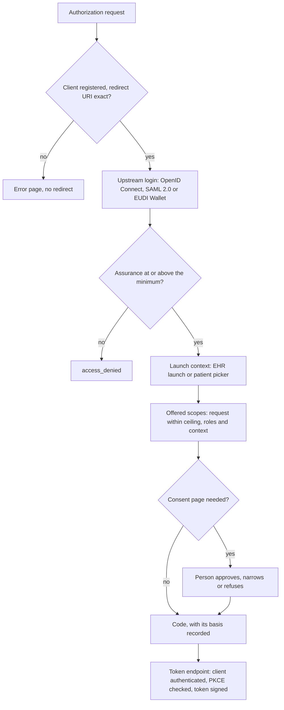

<!-- SPDX-FileCopyrightText: Cadasto B.V. -->
<!-- SPDX-License-Identifier: BUSL-1.1 -->

# How FerroSMART decides a token

**For:** integrators who write a SMART app or a resource server, operators
who configure FerroSMART, and compliance readers who sign off on who may
reach which data.

This page explains what FerroSMART weighs before it issues an access token,
and what the token then says. The how-to pages tell you what to configure;
this page tells you why the result comes out as it does. Each section names
the specification it follows. Where none governs a choice, the page says
it is FerroSMART's own design.

## The parts of a decision

A token answers four questions, and each has its own source of truth.

| Question | Decided by | Where you set it |
|---|---|---|
| Which app is asking, and is it who it says? | The client registry and the client's authentication | [The client document](../configure/clients.md#the-client-registry) |
| Who is the person, and how sure is FerroSMART? | The upstream login: OpenID Connect, SAML 2.0 or the EUDI Wallet | [Identity providers](../install/upstream.md) |
| Which server is the token for? | The request's `aud` or `resource`, held to the client's `resources` | `[[ferrosmart.resource]]` and the client's `resources` |
| What may the token do? | The request, narrowed by the client's ceiling, the person's roles, the launch context and the person's consent | `scope`, `[[ferrosmart.role]]`, the consent page |

The narrowest answer wins at every step. No page, registration or
remembered consent ever widens what the request, the ceiling and the roles
allow. SMART lets the server do this: "the scopes ultimately granted by
the authorization server may differ from the scopes requested by the
client" (SMART App Launch 2.2.0, Scopes and Launch Context).

## The app: registration and authentication

Every app is a client in FerroSMART's database, registered by an
administrator or, when `[ferrosmart.registration] open` is `true`, by
itself (RFC 7591 §3). The registration fixes the client's ceiling, the
`scope` it may ever hold, the servers its tokens may name in `aud`, its
redirect URIs and how it authenticates.

At the token endpoint the client proves who it is by the one method it
registered (RFC 6749 §2.3):

- a public client (`none`) by PKCE alone, the `code_verifier` that matches
  the `S256` challenge of its request (RFC 7636 §4.6);
- a confidential symmetric client by its secret, by HTTP Basic or in the
  form (SMART App Launch 2.2.0, Client Authentication: Symmetric);
- a confidential asymmetric client by a `private_key_jwt` assertion (RFC
  7523 §2.2) signed `RS384`, `ES384` or with ML-DSA (RFC 9964), each `jti`
  accepted once (SMART App Launch 2.2.0, Client Authentication:
  Asymmetric).

A request from an unknown client, or with a redirect URI the client did
not register, gets an error page and is never redirected (RFC 6749 §4.1.2.1).

## The person: the upstream login

FerroSMART is not an identity provider. It sends the person to a login you
configure and reads only the claims you map from it: an identifier, the
roles, and the person's `fhirUser`, the FHIR resource that names them
(SMART App Launch 2.2.0, Scopes and Launch Context, `fhirUser`).

- **OpenID Connect.** FerroSMART is the relying party. It checks the ID
  Token as OpenID Connect Core 1.0 §3.1.3.7 requires, including the
  `nonce` it sent.
- **SAML 2.0.** FerroSMART is a service provider of the Web Browser SSO
  profile (SAML 2.0 Profiles §4.1). It admits a signed response that
  answers its own request, names its audience and carries an
  authentication context you accept, once.
- **The EUDI Wallet.** FerroSMART is the verifier under OpenID4VP 1.0 and
  the OpenID4VC High Assurance Interoperability Profile 1.0. The person
  presents the person identification data (PID) in their wallet, and
  FerroSMART checks the issuer chain, the status, the key binding and the
  nonce. The PID's administrative number names the person; a `fhirUser`
  lookup or a patient index (PIXm ITI-83 or PDQm ITI-78) turns it into
  their `Patient`. FerroSMART never matches a person by name and birth
  date.

Each login has a level of assurance. Each provider's
`[ferrosmart.upstream.assurance]` maps its values to the eIDAS levels
`low`, `substantial` and `high`, and a wallet login is `high`. A login
below `[ferrosmart] assurance_minimum` (`substantial` by default, the least
Implementing Regulation (EU) 2026/2099 admits) is refused with
`access_denied`. An app that sends `acr_values` with an eIDAS level asks
for at least that level, and a lower login answers
`unmet_authentication_requirements` (RFC 9470 §5).

The person's `sub` at FerroSMART is pairwise: a SHA-256 of the provider's
issuer and the person's `sub` there. The provider's own identifier never
reaches a resource server, and two providers never collide (OpenID Connect
Core 1.0 §8, the `pairwise` subject type).

## The server: one audience per token

Every token is for exactly one server. The app names it as `aud` at the
authorization endpoint, as SMART asks, or as `resource` at the token
endpoint (RFC 8707 §2). The value must be one of the
`[[ferrosmart.resource]]` bases and one the client's `resources` lists;
anything else is refused with `invalid_target`. With one server configured,
a request that names none takes it.

A token for one server is useless at another, so a stolen token reaches
one server for at most `access_token_lifetime` (five minutes by default).

## The scopes: request, ceiling, roles, context

FerroSMART reads every SMART scope by its parts: context (`patient/`,
`user/`, `system/`), resource, permission letters and query parameters
(SMART App Launch 2.2.0, Scopes and Launch Context). A v1 scope such as
`patient/Observation.read` reads as its v2 letters, `rs`, and is granted
back as asked. A listed scope covers a requested one in the same context
with a subset of its letters, on the same resource or under `*`, with the
same query parameters or any when the listed one names none.

A requested scope is offered to the person only when each check holds:

| Scope | Offered when |
|---|---|
| `openid`, `profile`, `email` | The ceiling lists it |
| `fhirUser` | The ceiling lists it, `openid` is offered, and the login carried the person's `fhirUser` |
| `user/...` | The ceiling lists it and one of the person's roles grants it |
| `patient/...` | The ceiling lists it, a patient is in context, and a role grants it, or the person's `fhirUser` is that same patient |
| `launch`, `launch/patient`, `launch/encounter` | The ceiling lists it and the context answers it |
| `offline_access`, `online_access` | The ceiling lists it and the client registers `refresh_token` |
| an extension scope (`__...`) | The ceiling lists it and a role grants it |

A role never grants a `system/` scope, so no person's token carries one.
A patient using their own record needs no role: their `patient/` scopes
reach only that record. A standalone app that asks a `patient/` scope
without `launch/patient` is treated as asking it, since SMART lets the
server infer it (Scopes and Launch Context, Standalone apps).

## The launch context

A `patient/` scope needs a patient, and SMART carries the patient, and the
encounter when there is one, in the token response (SMART App Launch
2.2.0, Scopes and Launch Context). FerroSMART writes the same values into
the access token too, beside `fhirUser`, so a resource server that reads
the JWT has them (RFC 9068 §2.2.2, identity claims in the access token). At an openEHR
server the context names the EHR as `ehrId`.

- **EHR launch.** The EHR gives FerroSMART the context first, by
  registering it at `POST {issuer}/launch` or by signing it as a
  `launch+jwt`, and opens the app with the `launch` value. SMART does not
  say how an EHR hands its context over; both forms are FerroSMART's own
  design. A launch is bound to the EHR, the app and the server, lives five
  minutes and is redeemed once.
- **Standalone launch.** The patient picker chooses the patient. It
  searches the server as the person, under a grant of theirs to FerroSMART
  that lives 30 seconds, so the server's own rules decide which patients
  they see. A patient whose `fhirUser` names their own `Patient` sees no
  picker: their own record is the context. At an openEHR server that
  lists purposes of use, a professional declares one, and the lookups send
  it.

## Consent

SMART leaves the consent decision to the server: it "will enforce access
rules based on local policies and optionally direct end-user input"
(Obtain authorization code, Response). FerroSMART shows its consent page
where it protects the person, and records the basis of every code it
issues.

| The person | The app | The page |
|---|---|---|
| A professional (`fhirUser` a `Practitioner` or `PractitionerRole`) | Registered by an administrator | Not shown: the registration is the organisation's consent ("previous administrative consent", OpenID Connect Core 1.0 §3.1.2.4) |
| A patient, related person or person | The organisation's own, marked `first_party` | Not shown, the same ground |
| A patient, related person or person | Another party's | Shown: they decide which other party reads their data (Regulation (EU) 2025/327 Art 3, 4(2) and 7(1)) |
| Anyone | One that registered itself | Shown: its metadata is self-asserted (RFC 7591 §5) |
| Anyone | A public client without a claimed `https` redirect | Shown: the client's identity cannot be assured (RFC 8252 §8.6) |

A remembered choice answers a later request for the same client, the same
server and no more scopes. `prompt=consent` always shows the page. The
person sees every app that holds live access on the management page,
the SMART `management_endpoint`, and Disconnect revokes that app's grants
at once. [The consent rules](../configure/consent.md) list every case in
order.

## The three kinds of token

What a token says depends on who stands behind it. A resource server tells
the kinds apart by the claims, with no claim of FerroSMART's own.

| Kind | Grant | `sub` | Carries | Lifetime |
|---|---|---|---|---|
| Patient | Authorization code, by the patient or someone who speaks for them | The person's pairwise subject | `fhirUser`, when granted, a `Patient`, `RelatedPerson` or `Person`; `patient` in context; `patient/` scopes; `acr` and `auth_time` | `access_token_lifetime` |
| Professional | Authorization code, by a professional | The person's pairwise subject | `fhirUser`, when granted, a `Practitioner` or `PractitionerRole`; `user/` scopes, and `patient/` scopes with a patient in context; `roles`; `acr` and `auth_time` | `access_token_lifetime` |
| System | Client credentials, SMART Backend Services | The `client_id` | `system/` scopes within the ceiling; no person, no `roles`, no refresh token | At most five minutes |

Every access token is an RFC 9068 JWT, `typ` `at+jwt`, with `iss`, `sub`,
`aud`, `client_id`, `iat`, `exp`, `jti` and `scope`. It is signed `RS256`,
or `ML-DSA-65` (RFC 9964) for a client whose `id_token_signed_response_alg`
names it. `roles` holds the person's roles that a `[[ferrosmart.role]]`
names (RFC 9068 §2.2.3.1). The person's level of assurance rides as `acr`,
an eIDAS URI, beside `auth_time` (RFC 9068 §2.2.1).

For a Backend Services client, "the value of `sub` SHOULD correspond to an
identifier the authorization server uses to indicate the client
application" (RFC 9068 §2.2), so a resource server reads a token whose
`sub` is its `client_id` as a system caller. In IHE IUA terms, FerroSMART
is an Authorization Server with the JWT Token option for all three kinds
(IUA §34.2.2).

Two derived tokens follow the same rules:

- **The token exchange.** A confidential client that serves a FHIR base
  may exchange a person's own token there for a token at the paired
  openEHR base (RFC 8693 §2). A patient's token becomes one with their
  `patient` and `ehrId` and the `patient/` reads; a professional's becomes
  one with the `user/` reads and no patient. The new token keeps the
  person's `sub`, `fhirUser`, `acr` and `auth_time`, names the exchanging
  client as `client_id`, and carries no `act`: the product acts for the
  person, never as someone else.
- **The picker's token.** The patient picker searches with a token of the
  person for one server, under a grant of theirs to FerroSMART. It lives
  30 seconds and is revoked after the request.

## Binding a token to its client

By default an access token is a bearer token. A client can bind it to a
key it holds, so a stolen token is useless without the key:

- with a `DPoP` proof on the token request, the token's type is `DPoP` and
  its `cnf.jkt` names the proof's key (RFC 9449 §5, §6.1); a public
  client's refresh token is bound to the same key;
- with `tls_client_certificate_bound_access_tokens` in its registration,
  the token's `cnf` names the certificate of its mutual-TLS connection
  (RFC 8705 §3.1).

A client registered with `dpop_bound_access_tokens` must send a proof with
every token request.

## How long access lasts

An access token lives `access_token_lifetime`, five minutes by default and
at most one hour. Lasting access is a refresh token, which needs a refresh
scope granted:

- `online_access` lasts while the person's login at the provider does: a
  back-channel or front-channel logout, a logout at FerroSMART's
  end-session endpoint, or `online_idle` unused ends it;
- `offline_access` outlives the login, until `refresh_idle` unused, a
  revocation or a Disconnect.

Every refresh rotates the refresh token. A rotated token presented again
revokes the whole grant, unless the same client repeats it within ten
seconds while its successor is unused, which covers a lost response or two
tabs refreshing at once (RFC 9700 §4.14.2; the ten-second window is
FerroSMART's own design).

## Where to go next

- To register a client and its ceiling: [clients, roles and consent](../configure/clients.md).
- To configure who logs in: [identity providers](../install/upstream.md).
- To read the tokens at a server: [a server behind FerroSMART](../integrate/resource-server.md).
- To see each request as an app makes it: [the flows](../integrate/flows.md).
