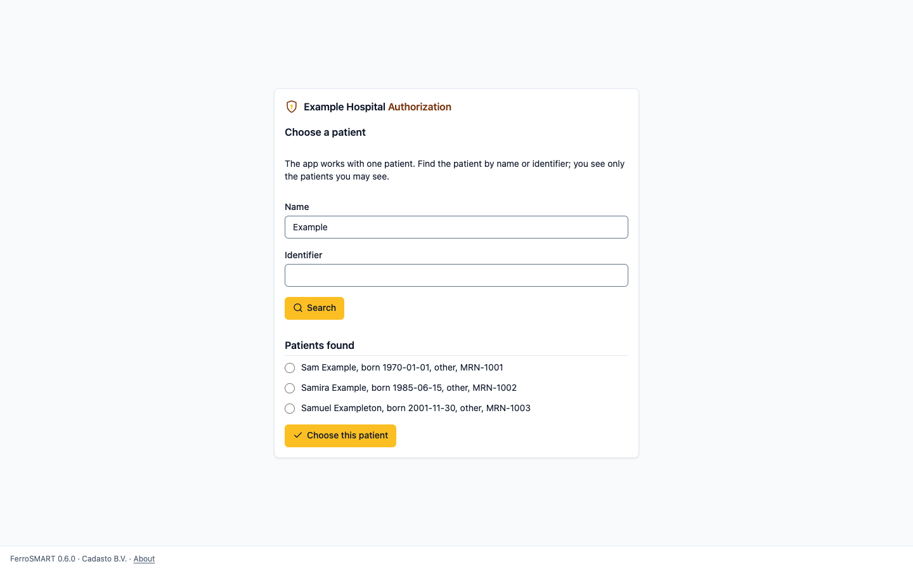
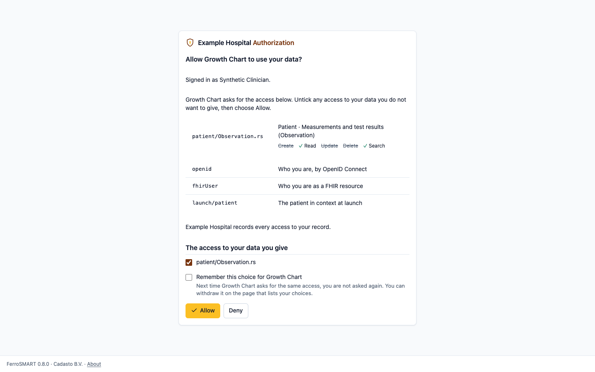
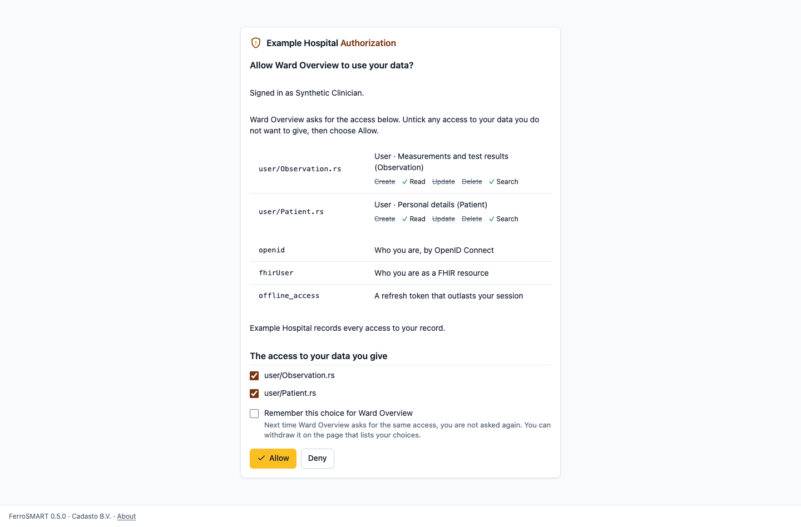
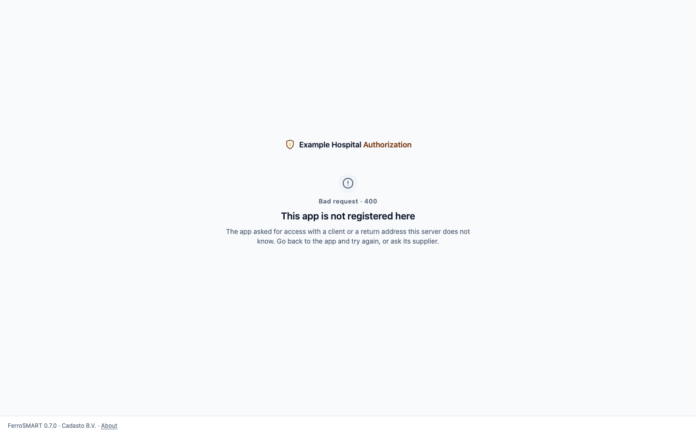
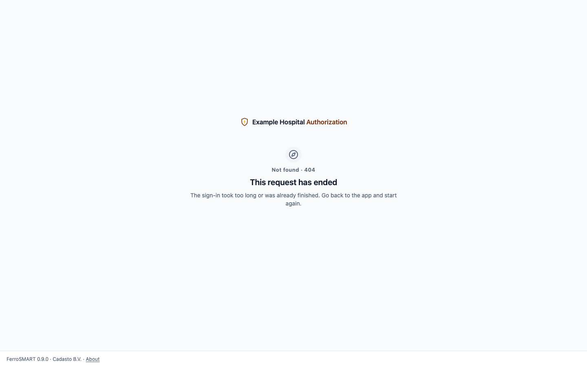
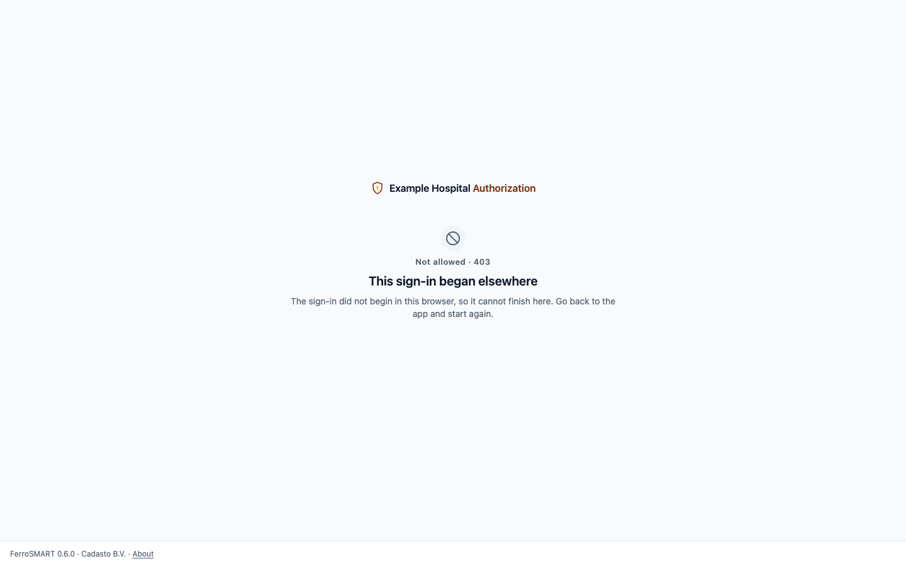
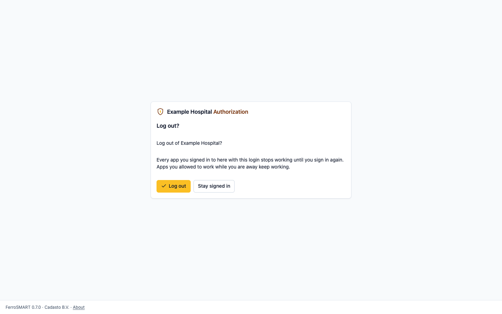
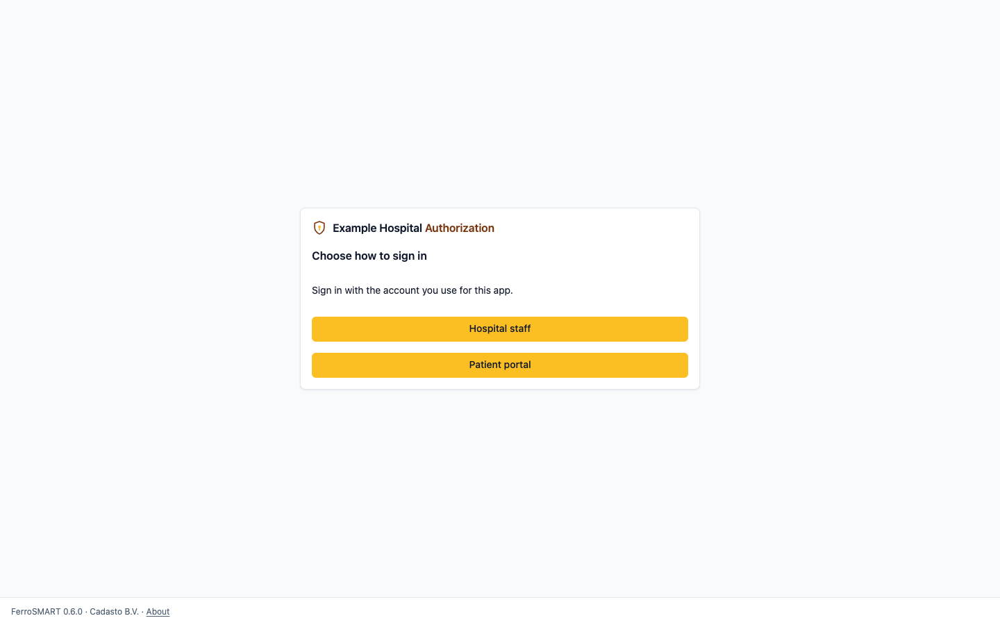

<!-- SPDX-FileCopyrightText: Cadasto B.V. -->
<!-- SPDX-License-Identifier: BUSL-1.1 -->

# The flows

An app finds FerroSMART through the FHIR or openEHR server it wants to
reach: the server's own `.well-known/smart-configuration` names FerroSMART's
`authorization_endpoint` and `token_endpoint`. Everything below follows
[SMART App Launch 2.2.0](https://hl7.org/fhir/smart-app-launch/STU2.2/).

## The standalone launch

1. **Authorize.** The app sends the person to `{issuer}/authorize` with a
   `GET` or a form `POST`: `response_type=code`, its `client_id`, a
   registered `redirect_uri`, `scope`, `state`, a PKCE `code_challenge`
   with `code_challenge_method=S256`, and `aud`, the base URL of the server
   the token is for (`resource` is taken as a synonym). SMART requires the
   app to send `aud`, so send it. A deployment that configures one resource
   server takes a missing `aud` as that server, as its token endpoint does
   for `resource`; with two or more, a request without `aud` is refused. An
   `aud` FerroSMART does not serve is refused. An unknown client or redirect URI is shown to
   the person and never redirected to.
2. **Log in.** FerroSMART sends the person to the identity provider and
   back to `{issuer}/callback`. When the app's client may use more than one
   provider (its `upstreams`, or every provider when it names none), the
   person first chooses one at `{issuer}/login`.
3. **Pick the patient.** When the app asks for `launch/patient` and the
   server can be searched, FerroSMART shows its patient picker. A
   standalone app that asks a `patient/` scope without `launch/patient` is
   treated as asking it, and the granted `scope` says so. A patient
   whose `fhirUser` names their own `Patient` at that server (or at the
   FHIR server paired with the openEHR server asked) sees no picker: their
   own record, read again as them, is the context, and they get the app's
   `patient/` scopes without a role at the identity provider. At a FHIR
   server the person searches by name or identifier
   (`GET [base]/Patient`); at an openEHR server whose
   `[[ferrosmart.resource]]` names a `subject_namespace`, the person enters
   the patient's identifier and FerroSMART looks the EHR up
   (`GET [base]/ehr?subject_id=…&subject_namespace=…`). At an openEHR
   server paired with its platform's FHIR server (`fhir_base`), the person
   searches the FHIR server instead, and FerroSMART looks the chosen
   patient's EHR up by the identifier `subject_system` names, so the
   context carries both `patient` and `ehrId`. At an openEHR server that
   lists purposes of use (`[[ferrosmart.resource.purpose]]`), a
   professional chooses one on the picker page, and the lookups send it
   in the server's purpose header. The search runs as
   the person, with a token of their own for that one server that lives 30
   seconds and is revoked after the request, so the server's rules decide
   which patients they see. The chosen patient is read again as them before
   it enters the context. When the app also asks for `launch/encounter` at
   a FHIR server, the picker then lists that patient's encounters
   (`GET [base]/Encounter?patient=…`, as the person, with the scope
   `user/Encounter.rs`); the person chooses one or goes on without, and
   the chosen encounter is read again and must belong to the patient.
4. **Consent.** The person approves the scopes on the consent page
   ([clients, roles and consent](../configure/clients.md#consent)).
5. **The code.** FerroSMART redirects to the app with `code`, the `state` as
   sent, and `iss` (RFC 9207). The code lives 60 seconds and is single use;
   a second use revokes everything the first one issued.
6. **The token.** The app posts to `{issuer}/token` with
   `grant_type=authorization_code`, the `code`, the same `redirect_uri` and
   the `code_verifier`, a public client with its `client_id`, a confidential
   one with its client assertion.



The patient picker, with a search and its results.
[Dark theme](img/picker-dark.png).



The consent page of an app that reads one patient's record.
[Dark theme](img/consent-patient-dark.png).



The consent page of an app a clinician uses across patients.
[Dark theme](img/consent-clinician-dark.png).

When a request cannot go on, FerroSMART tells the person on a page of its
own and never redirects to an address it has not checked.



A request from an app nobody registered.
[Dark theme](img/error-unknown-client-dark.png).



The consent page reached after the request lapsed.
[Dark theme](img/error-lapsed-dark.png).



A login that came back to a browser that did not begin it.
[Dark theme](img/error-other-browser-dark.png).

The token response carries `access_token`, `token_type: Bearer`,
`expires_in`, the granted `scope`, an `id_token` when `openid` was granted,
a `refresh_token` when a refresh scope was, and the launch context:
`patient` (or `ehrId` at an openEHR server), `encounter`, `fhirContext`,
`need_patient_banner`, `intent` and `tenant` as the launch set them, and
`smart_style_url` when the deployment configures one. Every token response
carries `Cache-Control: no-store` and `Pragma: no-cache`. A browser app's
token request from one of its registered origins, the origins of its
redirect URIs, gets a CORS answer for that origin; any other origin gets
none.

### A pushed request

An app can push its authorization request first (RFC 9126): it posts the
same parameters to `POST {issuer}/par`, authenticating as it does at the
token endpoint, and gets `201` with a `request_uri` that lives 60 seconds.
It then sends the browser to `/authorize` with its `client_id` and that
`request_uri` alone. FerroSMART takes the pushed request once; a second use,
a lapsed one or another client's answers the page that says the request
lapsed. A deployment that sets `require_pushed_authorization_requests`, or
a client registered with it, refuses a request that was not pushed with
`invalid_request`.

## The EHR launch

The EHR first gives FerroSMART the context and gets a `launch` value back,
then opens the app with `iss` and `launch`
([the EHR launch API](ehr-launch.md)). The app asks for the `launch` scope
and passes the value to `/authorize`; the rest is the standalone flow
without the picker, and the token response carries the context the EHR
registered.

## What an app should expect

Three behaviours are fixed. Each one protects the person or the deployment,
and an app works with it in the way described here.

**"Remember this choice" is off by default, for the exact scopes asked.**
The consent page asks again unless the person ticks "Remember this
choice", and a remembered choice answers only a later request for the same
scopes or fewer; a request for more shows the page again. This keeps the
patient in control of what each app holds (SMART App Launch 2.2.0, Best
Practices). Ask for the same scopes on each launch, so a remembered choice
applies, and the person can disconnect the app on the management page
(`management_endpoint`).

**Access tokens live five minutes.** `access_token_lifetime` defaults to
five minutes, the same default Keycloak uses. An app that works longer than
that asks for `online_access`, a refresh token that lives while the person's
login at the identity provider does, or `offline_access`, one that outlives
it, and refreshes before the token expires (SMART App Launch 2.2.0, Refresh
access token). The authorization server metadata lists `refresh_token` in
`grant_types_supported` (RFC 8414 §2), so a client that reads it knows the
grant is served. A rotated refresh token presented again within ten seconds
by the same client gets the same answer, so a retry is safe.

**FerroSMART's pages refuse to be framed.** Every page answers with
`frame-ancestors 'none'` and its cookie is `SameSite=Lax`, which keeps
another site from overlaying the consent page (clickjacking, RFC 9700
§4.16). Microsoft Entra ID's sign-in refuses framing as well. An app that
runs inside an EHR's iframe opens the authorization request in a new window
or tab, and that window returns to the app's redirect URI as usual.

## The tokens

An access token is an RFC 9068 JWT, `typ` `at+jwt`, signed `RS256` with a
key published at `{issuer}/jwks`. It carries `iss`, `sub`, `aud`,
`client_id`, `iat`, `exp`, `jti` and `scope`, and the context the response
carried: `patient`, `encounter`, `fhirUser`, and `ehrId` at an openEHR
server. Its `aud` is the one base the request named. It lives
`access_token_lifetime`, five minutes by default.

A person's `sub` is pairwise: derived from the identity provider's issuer
and `sub`, so two providers never collide and the provider's identifier
never reaches a resource server. The ID Token, signed `RS256`, carries
`iss`, `sub`, `aud`, `exp`, `iat`, `nonce` when the app sent one,
`auth_time`, and `fhirUser` when `fhirUser` was granted. When the client's
ceiling lists `profile` or `email` and the app asks for them, the ID Token
also carries `name` and `preferred_username` (`profile`) and `email` and
`email_verified` (`email`) as the identity provider sent them, so a
standard OpenID Connect library can show who is signed in. The `sub`
stays pairwise.

## Backend Services

A system with no person uses the client credentials grant with a client
assertion (SMART App Launch 2.2.0, Backend Services):

```http
POST /token HTTP/1.1
Host: smart.example.org
Content-Type: application/x-www-form-urlencoded

grant_type=client_credentials
&scope=system%2FObservation.rs
&client_assertion_type=urn%3Aietf%3Aparams%3Aoauth%3Aclient-assertion-type%3Ajwt-bearer
&client_assertion=eyJ...
&resource=https%3A%2F%2Fehr.example.org%2Ffhir
```

`resource` names the server (RFC 8707); it may be left out when FerroSMART
serves one server alone, and FerroSMART's own issuer is a resource too, for
the introspection and audit endpoints. The granted scope is the request
within the client's ceiling, and the response has no refresh token. The
token's `sub` is the client id.

## Refresh, introspection and revocation

**Refresh.** A refresh token comes with `offline_access` or
`online_access` granted. `grant_type=refresh_token` with the token, and a
`scope` equal to the grant's or narrower, returns a new access token and a
new refresh token: FerroSMART rotates every client's refresh token on each
use. A rotated token presented again revokes the grant with every token
under it, except within 10 seconds of its rotation: the same client
presenting it again then gets the same new refresh token and a fresh access
token, so a retry after a lost response, or two tabs or two backend
instances refreshing at once, keeps the grant. A repeat after the window,
by another client, or once the new refresh token was used, is a replay. An `offline_access` token lapses after
`refresh_idle` unused; an `online_access` token after `online_idle`, or when
the person's login at the identity provider ends through back-channel or
front-channel logout, or at FerroSMART's end-session endpoint.

**Logout.** An app sends the person to `end_session_endpoint`
(`{issuer}/logout`, OpenID Connect RP-Initiated Logout 1.0) with the ID
Token FerroSMART gave it as `id_token_hint`, and optionally a
`post_logout_redirect_uri` the client registered under
`post_logout_redirect_uris` and a `state`. FerroSMART asks the person to
confirm, ends their `online_access` grants (an `offline_access` grant
lives on), and sends the browser to the identity provider's own logout
when it has one. The browser then comes back to the app's
`post_logout_redirect_uri` with the `state`, or, when the app sent no
`id_token_hint`, to FerroSMART's own logged-out page. A hint FerroSMART did
not issue, a `client_id` that is not the hint's audience, or a redirect URI
the client did not register is a page and no redirect.



The end-session endpoint's confirmation.
[Dark theme](img/logout-confirm-dark.png).



The chooser of an app whose people log in at either of two providers.
[Dark theme](img/chooser-dark.png).

**Introspection.** `POST {issuer}/introspect` (RFC 7662) answers for any
token FerroSMART issued. The caller is a confidential client that
authenticates as at the token endpoint, by its `private_key_jwt` assertion
or its client secret (HTTP Basic or the form), or presents a bearer token
FerroSMART issued for its own issuer; either way it holds
`system/introspect` in its ceiling. A gateway that introspects with
`client_secret_basic`, such as Apache APISIX, registers as a confidential
symmetric client. A public client cannot introspect. An
active token's answer carries `active: true`, `scope`, `client_id`, `exp`,
the launch context of the original response, and `iss` and `sub` of an ID
Token that was issued; anything else answers `{"active": false}` alone.

**Revocation.** `POST {issuer}/revoke` (RFC 7009) takes a token the calling
client holds: a confidential client authenticates, a public client sends
its `client_id`. Revoking a refresh token revokes its grant with every token
under it; revoking an access token revokes that token. An unknown token
answers `200`; another client's token is refused with
`unauthorized_client`.
