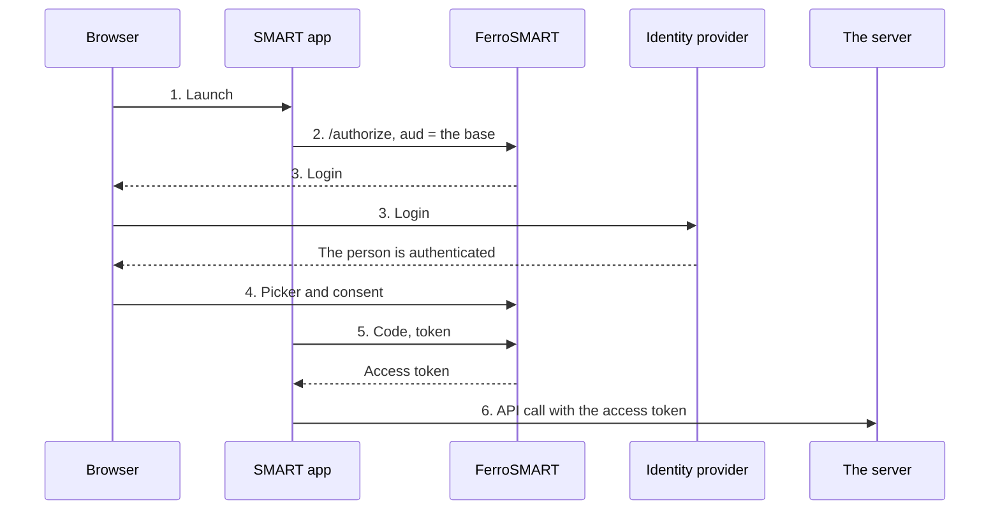

<!-- SPDX-FileCopyrightText: Cadasto B.V. -->
<!-- SPDX-License-Identifier: BUSL-1.1 -->

# Put a server behind FerroSMART

**For:** integrators of a FHIR or openEHR server that accepts FerroSMART's tokens.

A FHIR or openEHR server sits behind FerroSMART as a resource server: it
reads the tokens FerroSMART issues and never sees the person log in. The
identity provider runs upstream for login only.



## On FerroSMART's side

Name the server's base as a resource, so a launch can use it as `aud`:

```toml
[[ferrosmart.resource]]
base = "https://ehr.example.org/openehr/v1"   # or the FHIR base
kind = "openehr"                               # or "fhir"
subject_namespace = "examples"                 # openEHR only: the picker's EHR lookup
```

When the platform also serves FHIR, pair the two bases. The picker then
finds the patient at the FHIR server and their EHR at the openEHR server,
and the app gets both `patient` and `ehrId`:

```toml
[[ferrosmart.resource]]
base = "https://ehr.example.org/fhir"

[[ferrosmart.resource]]
base = "https://ehr.example.org/openehr/v1"
kind = "openehr"
subject_namespace = "examples"
fhir_base = "https://ehr.example.org/fhir"     # the platform's FHIR base, configured above
subject_system = "urn:example:mrn"             # the Patient.identifier that names the EHR's subject
```

## On the server's side

The server checks each token as an RFC 9068 JWT:

- the signature with a key from FerroSMART's `jwks_uri`, refetched on an
  unknown `kid`, so a [rotated key](../operate/keys.md) is found;
- `typ` `at+jwt`, `iss` FerroSMART's issuer, `aud` its own base, `exp`;
- the `scope` claim against what the request needs, and the context
  claims `patient`, `encounter`, `fhirUser` and `ehrId` for whose data it
  is;
- the `roles` claim (RFC 9068 §2.2.3.1), when the server takes roles from
  its issuer: the person's roles at the identity provider that a
  `[[ferrosmart.role]]` names, carried by every token of a user flow and
  never by a Backend Services token. The server decides itself whether it
  trusts FerroSMART for roles (FerroEHR's `role_issuers`), and a privileged
  role such as an emergency access role needs its own `[[ferrosmart.role]]`
  table to reach it.
  The patient picker's own short-lived token carries the same `roles`,
  and at an openEHR server that lists purposes of use its lookups declare
  the professional's chosen purpose in the server's purpose header
  ([configuration](../configure/configuration.md#ferrosmartresource)).

A server that cannot read JWTs introspects instead
([the flows](flows.md#refresh-introspection-and-revocation)), as a
registered client whose ceiling lists `system/introspect`.

The server serves its own `.well-known/smart-configuration`, as SMART asks
of every FHIR endpoint that requires authorization, and names FerroSMART's
`authorization_endpoint` and `token_endpoint` in it, so an app that starts
at the server finds FerroSMART.

## A FerroHEALTH product

Every FerroHEALTH product does this through `ferrohealth-smart`, the crate
the FerroSMART repository publishes. It trusts FerroSMART in one named
issuer table that names only the issuer. The crate reads every token by
RFC 9068 and SMART App Launch 2.2: `typ` is `at+jwt`, `scope` is required,
and the `patient` claim is the launch context. The audience is the
product's own base URL unless the table names another:

```toml
[auth.issuer.smart]
issuer = "https://smart.example.org"
```

An app is registered once, at FerroSMART. Give each client document the
bases its tokens may name in `resources`
([clients](../configure/clients.md#the-client-registry)); FerroSMART then
refuses a token for any other base with `invalid_target`. A token that names
the product in `aud` was issued for it (RFC 9068 §4, RFC 8707), so the
product admits its app and keeps no list of apps of its own. The app is
recorded with each request, and the product's own access policy still
decides every request.

The same table reads a Backend Services token as a system caller, because
its `sub` is its `client_id`. A user is named by the resource type of their
`fhirUser`: a `Patient`, a `Practitioner`, a `PractitionerRole`, a
`RelatedPerson` or a `Person`, and a user of no stated type when the token
carries none. A token is the patient's own access when its `fhirUser` is
`Patient/<x>`, its `patient` is `x`, and it names no actor; a
`RelatedPerson` with a patient in context is that patient's representative.
An RFC 8693 `act` names the actor beside the user, as FerroSMART asserts
it. The product's own SMART document describes
FerroSMART, and its own rules still apply on top of the token's scopes.
Every other key names the issuer by its table's name (`smart` here), and
the environment form does too: `FERROEHR__AUTH__ISSUER__SMART__AUDIENCE`.
An unknown name is refused at start, with the known names listed.
Each product's book has the details of its `[auth]` section.

### Federation issuers

Every issuer is read from the standard claims of a SMART App Launch 2.2
token unless its table declares `kind = "federation"`: another party's
issuer, whose tokens name its professionals or its organisation. Its
`[auth.issuer.<name>.federation]` table says how they are read, and its
`[auth.issuer.<name>.profile]` table may name the token types and the
required claims it writes.

The products ship no country content. This example table maps the Dutch
harmonised authentication of the openEHR Federation Tier specification
1.0.1 Annex B §B.4a, each value with its source. A deployment copies it,
adds the issuer, its audience, the `token_types` it observes and its URA in
`[auth.issuer.nl.federation.fields]`:

```toml
{{#include profiles/nl-annex-b.toml}}
```

#### The treatment relationship fields

A federation table maps these fields of a treatment relationship
confirmation, each from a claim, a credential subject path, an attested
`authorization_details` member or a constant, as it maps the professional
and provider fields:

| Field | Value |
|---|---|
| `trc.id` | The confirmation's identifier, one string |
| `trc.not_before` | The start of its window, in seconds since the epoch |
| `trc.not_on_or_after` | The end of its window, in seconds since the epoch |
| `trc.care_role` | The care role it attests for the professional: one coded value with its code system, as a FHIR Coding `[{ "system": "…", "code": "…" }]` or a configured `{ constant = "…", system = "…" }`; a string, a code without a system or two codes refuse the token (`attribute-refused`) |

The products name no care role value set: the deployment's access policy
names the one it reads. A contact point's token that carries any of these
fields carries `trc.id` and both window bounds.

### Why a token was refused

A product refuses a token with `401` and `error="invalid_token"`, or a
request its token does not permit with `403` and
`error="insufficient_scope"`, with a stable reason code as
`error_description`. [Refusal codes](refusals.md) lists every code.

A product starts whether or not FerroSMART is up: it reads FerroSMART's
metadata in the background, retrying with a back-off of one second doubling
to one minute, and reports not ready on its readiness route until the read
succeeds. Until then it refuses FerroSMART's tokens with `503` and the code
`issuer-unread`, so the two can start in any order.

For a server of your own in Rust, add the crate with its axum layer:

```sh
cargo add ferrohealth-smart -F axum
```

Its documentation is on [docs.rs](https://docs.rs/ferrohealth-smart).
